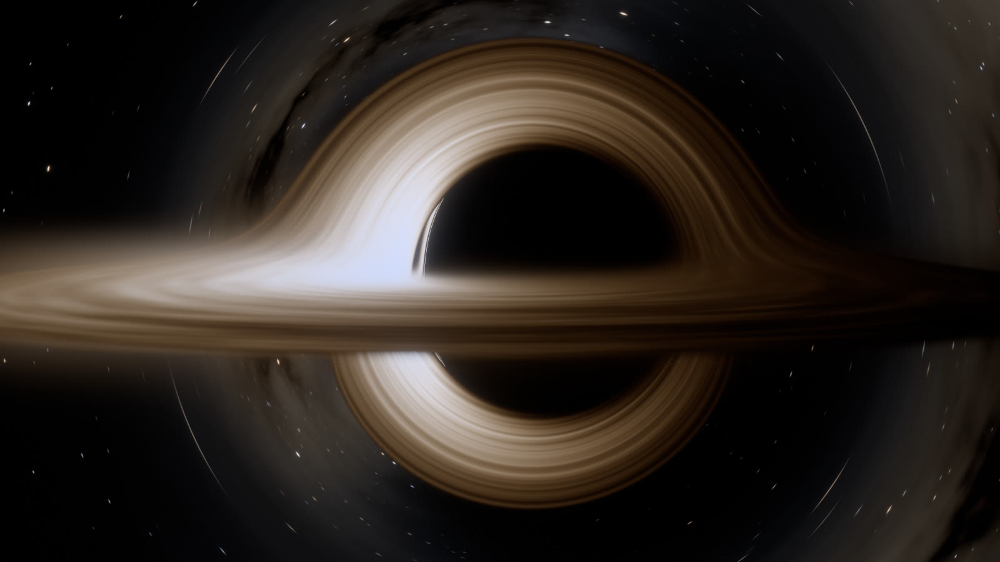
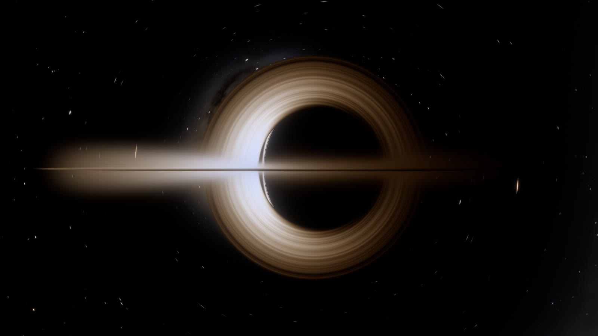
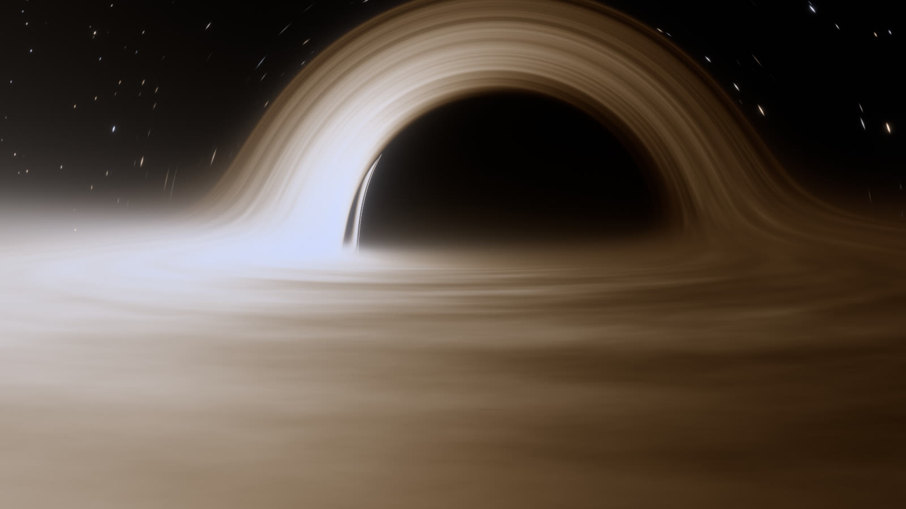
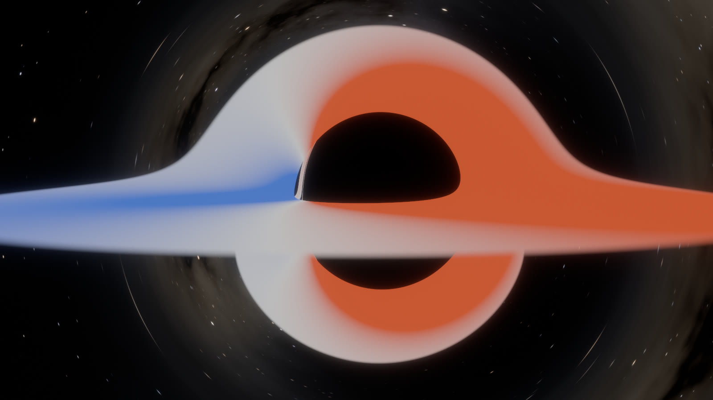
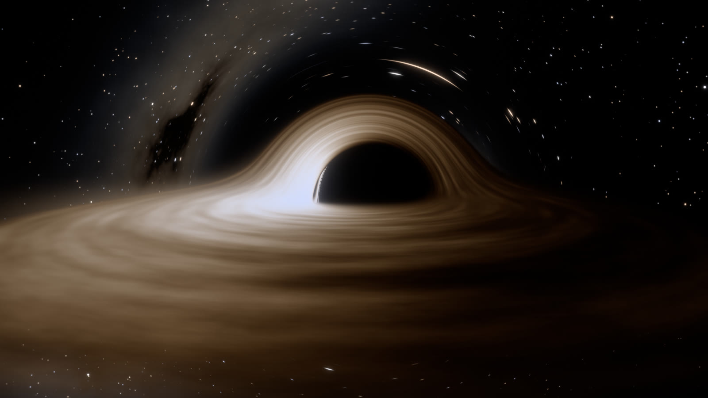

# web-blackhole

A real-time spinning (Kerr) black hole, ray traced from scratch on WebGPU with no engine or rendering library. Every pixel follows a light ray backwards through curved spacetime. It draws the shadow, the lensed accretion disk with its Doppler and gravitational shifts, the photon ring and a lensed starfield. You can orbit it, fly around it, and change its spin while it runs.

**Live demo: https://theanandprasad.github.io/web-blackhole/** (needs a browser with WebGPU)



| Edge-on, 40 M | Close-up, 11 M, 70° field of view |
|---|---|
|  |  |

| Redshift map (blue: g > 1, red: g < 1) | Free flight below the disk plane |
|---|---|
|  |  |

## Run it

Open the [live demo](https://theanandprasad.github.io/web-blackhole/), or open `blackhole.html` in a browser with WebGPU (recent Chrome, Edge or Safari). `blackhole.min.html` is the same page minified. Both are single self-contained files that work from `file://`.

To run from source:

```
npm start        # serves http://localhost:8090/
npm test         # physics checks against analytic results
npm run build    # regenerates blackhole.html and blackhole.min.html
```

## Controls

| Input | Action |
|---|---|
| Drag | Orbit the black hole |
| Mouse wheel / pinch | Zoom |
| F | Free flight: click to capture the mouse, WASD to move, E/Q up and down, Shift for 5x |
| Space | Pause time |
| P | Photo mode: hides the HUD, freezes time and keeps refining the frame with jittered samples |
| R | Reset the camera |
| O | Auto-orbit (turntable) |
| I | Show or hide the explanation card |
| H | Settings panel: presets, spin, disk size and temperature, Doppler amount, gas texture, limb darkening, atmosphere, sky, exposure, bloom, field of view, observer, debug views, and a button that copies a link to the current view |

URL parameters set up exact shots. `cam=dist,inclination,azimuth` positions the orbit camera (in M and degrees), `fly=x,y,z,yaw,pitch` places a free camera, `w=1920&h=1080` forces the canvas size, `scale=1` fixes the render scale, `ui=0` hides the HUD, `t=` sets the time in M, and any settings key works too, for example `spin=0.998&doppler=0&fov=60`.

## How it works

### Light rays

Units are G = c = M = 1. The metric is written in Cartesian Kerr-Schild coordinates, g = η + f l l. These have no coordinate singularity at the horizon or on the spin axis, so one integrator works everywhere the camera can go. Each pixel's ray starts as a null covector built in the camera observer's local frame. The default observer hovers at fixed position (static observer); inside the ergosphere, where hovering is impossible, it switches to a free-falling one. The ray is integrated backwards with the Hamiltonian form of the geodesic equation, H = ½ g^μν k_μ k_ν, using the closed-form gradient of the Kerr-Schild metric and fourth-order Runge-Kutta. k_t is conserved, so the state is six numbers.

Steps scale with distance from the hole (15% of r per step). Inward progress per step is also capped at a fraction of the remaining distance to the horizon, because a captured ray traced backwards heads for the past horizon and its momentum diverges there. Far outside the disk the steps grow 3x, and the last bit of weak-field bending beyond the escape radius is added analytically.

Every ray's conserved quantities ξ = L_z/E and η = Q/E² are known at the camera. So whether it will be captured is decided analytically against Bardeen's critical curve, and a doomed ray stops as soon as it has passed inside the disk's inner edge. This removes the slowest rays, which near extremal spin would otherwise spiral through the near-horizon throat for over a thousand steps.

### The disk

The disk is a geometrically thin, optically thick Novikov-Thorne disk from the innermost stable circular orbit (ISCO) outwards. Its temperature profile comes from integrating the Page-Thorne flux formula. Each crossing of the equatorial plane is refined with a partial RK4 step, and up to three crossings are kept: the direct image and the higher-order images bent around the hole.

At each crossing, the redshift factor g = ν_obs/ν_emit for gas on a prograde Keplerian orbit is computed exactly from the ray's momentum and the orbit's 4-velocity. The pixel colour is a Planck spectrum at g·T, integrated against the CIE 1931 colour matching functions. A blackbody seen with frequency shift g is a blackbody at temperature g·T, so this one step accounts for Doppler beaming, the colour shift and the gravitational redshift together. A slider scales the shift down to zero for a film-style symmetric look.

The gas texture is advected at the local Keplerian angular velocity, so differential rotation shears it into spirals. Two flow-map layers restart every half local orbit and crossfade, which keeps the winding bounded at every radius. Noise octaves are filtered by each pixel's footprint on the disk, taken from screen-space derivatives of the hit positions. Above and below the disk sits a thin atmosphere: gas with a Gaussian vertical profile, in local thermodynamic equilibrium at the disk temperature. Its column along each ray step is integrated analytically (an erf), giving an optical depth in the gas frame. Each step emits B(gT)(1 − e^−τ) and dims everything behind it by e^−τ, so grazing views saturate at the blackbody limit instead of exceeding it. The disk surface itself has electron-scattering limb darkening, I ∝ 1 + 2.06 μ, where μ = |k_z| g is the emission-angle cosine in the gas frame.

### The sky

Stars are point sources splatted with a Gaussian as wide as the pixel's footprint on the sky, measured after lensing. This conserves their flux: where the hole magnifies, stars brighten and stretch into arcs, and where it demagnifies, near the shadow, they merge into the mean glow of the star field. Einstein rings of background stars appear by themselves. The Milky Way, with dust lanes and nebulae, is baked once into a mip-mapped cube map and sampled at a level matching the same footprint.

### Image

The trace renders into an HDR target. A resolve pass accumulates jittered frames with the history clamped to the current frame's neighbourhood. The shader also estimates how many pixels the gas moves per frame (orbital speed times time step, over the pixel's footprint on the disk), and the resolve drops history where that is more than about a pixel. Lensing makes real motion vectors impractical, so this anti-aliases the static thin photon ring without smearing the fast inner disk. With time paused it converges to a supersampled still. Then comes bloom, with its input capped so a very bright inner disk can't flood the shadow with glare. AgX tone mapping is blended with a hue-preserving variant, so blueshifted gas stays blue instead of going white. Dithering follows, and the render resolution adapts to hold the frame rate.

## Checks

`npm test` checks the integrator against closed-form results:

- Hamilton's equations against finite differences of H
- camera rays are null, with unit energy in the observer frame
- the null constraint, L_z and the Carter constant are conserved along strongly bent rays
- the Schwarzschild critical impact parameter is 3√3 M
- the Kerr shadow edge matches Bardeen's critical curve, for a = 0.9, 0.998 and −0.6, viewed equatorially and at 55°
- the analytic capture test agrees with integration on random rays

Separately, at the default step size, disk-hit radii agree with a 7.5x finer integration to 3 × 10⁻⁴ (relative, 99th percentile) for the direct image and 0.2% for the first lensed image.
- ISCO radii (6 M, 1.237 M at a = 0.998, 9 M retrograde), the √(1 − 3/r) transverse redshift, the Novikov-Thorne peak near 9.5 M, and blackbody colours

## Performance

Measured on an Apple M4 (10-core GPU) in Chrome 155, default view:

| Render resolution | GPU time per frame |
|---|---|
| 1920 × 1080 | about 19 ms (a = 0.998: 20 ms) |
| 1600 × 900 | about 13 ms |
| Full-screen retina window (3024 × 1964 canvas), automatic resolution | settles at 1415 × 919, about 13 ms |

Rays average about 40 RK4 steps. The analytic capture test and the coarser far-field steps each cut the work by roughly a third. The galaxy is a texture lookup, but the stars and the disk texture are procedural, filtered per pixel. Render resolution adapts to keep GPU time near 12 ms per frame, and the HUD shows FPS and GPU time when the browser supports `timestamp-query`.

## Known limitations

- The disk surface is infinitely thin; its thickness comes only from the emitting, absorbing atmosphere layer, which has no texture of its own.
- Light travel time is ignored: the whole disk is drawn at one coordinate time.
- The free camera cannot cross the horizon; it stops just outside.
- Default disk temperatures (thousands of kelvin) are chosen to look good. Real disks around supermassive black holes peak far hotter and would look blue-white; set the temperature slider to 20000 K or more to see that.

## How it was made

Built with Claude Code (Opus 5.5) after studying [web-ocean](https://github.com/Noniv/web-ocean), using the same method. The physics was written first, as a CPU reference in `js/physics.js`, and checked against analytic results before any shader existed. That caught two real integrator bugs early: rays falling into the past horizon blowing up numerically, and the capture radius sitting on the prograde photon orbit at a = 0.998. `tools/shoot.mjs` renders exact shots in headless Chrome from URL parameters, and `tools/sheet.sh` puts variants side by side. Two independent critic agents reviewed the renders, one for physical correctness and one for the look. Several of their findings changed the renderer: an opaque disk, flux-based texture, limb darkening, sky blueshift, hue-preserving tone mapping, the temperature normalisation at a fixed accretion rate, and the framing of the default view.

## Repository layout

| Path | Contents |
|---|---|
| `index.html` | Page shell, HUD and settings panel styles |
| `js/main.js` | Device setup, resources, camera, UI, frame loop |
| `js/physics.js` | Kerr metric, geodesic equations, observer frames, ISCO, Novikov-Thorne profile, blackbody colours (shared by the renderer and the tests) |
| `js/wgsl/` | Shaders as JavaScript modules: `trace.js` (ray tracing, disk, stars), `sky.js` (galaxy cube-map bake), `post.js` (temporal resolve, bloom, tone mapping), `common.js` (shared uniforms and noise) |
| `test/physics.test.mjs` | Physics checks |
| `tools/` | Headless screenshot runner and contact-sheet script used for visual review |
| `server.mjs` | Tiny static server for development |
| `build.mjs` | Builds `blackhole.html` and `blackhole.min.html` |

## License

MIT. See [LICENSE](LICENSE).
